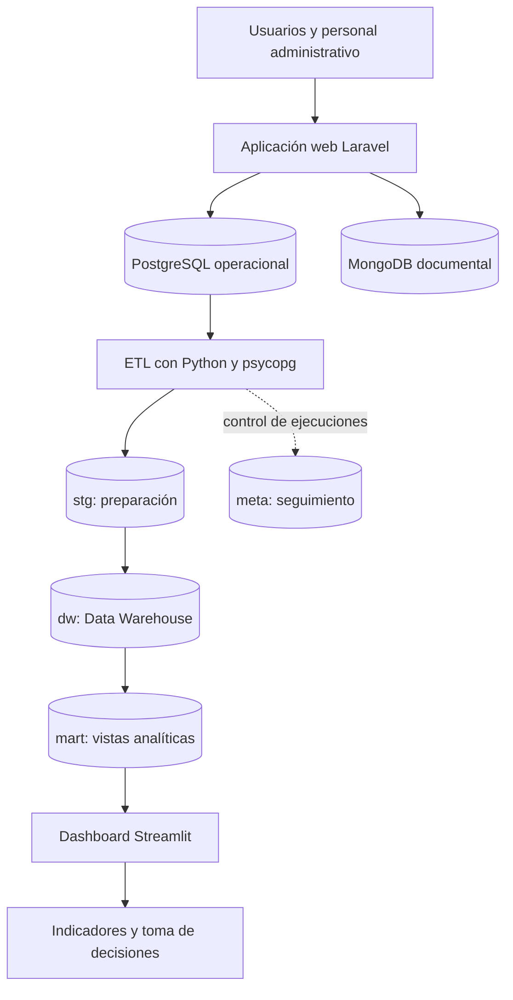

# SIDAN

### Sistema Integrado de Datos y Analítica de Negocios

**Gestión de actividades y operaciones comerciales, integrada con inteligencia de negocios para apoyar la toma de decisiones.**

**Proyecto académico · Universidad de El Salvador · 2026**

---

## Descripción general

**SIDAN** es una solución web configurable diseñada para organizaciones que necesitan centralizar la administración de **actividades, inscripciones, órdenes, cobros, comprobantes internos y entregas**, y convertir la información generada por estos procesos en indicadores para el análisis y la toma de decisiones.

El proyecto integra dos componentes complementarios:

- **Sistema operacional (OLTP):** permite registrar y administrar las actividades y transacciones del día a día mediante una aplicación web desarrollada con Laravel.
- **Sistema analítico (BI/OLAP):** procesa información operacional mediante un flujo ETL en Python, la organiza en un Data Warehouse dimensional en PostgreSQL y la presenta en un dashboard desarrollado con Streamlit.

La solución está orientada a escenarios académicos, institucionales, comerciales y de servicios en los que existen distintas modalidades de actividades, participantes y operaciones de cobro.

## Funcionalidades principales

| Área | Capacidades del sistema |
| :--- | :--- |
| **Actividades** | Creación, configuración, clasificación, revisión y publicación de actividades. |
| **Organización** | Administración de categorías, etiquetas, recursos, espacios y sesiones. |
| **Participantes** | Inscripciones, seguimiento de registros y consulta de información asociada a actividades. |
| **Operaciones comerciales** | Gestión de órdenes, compras, conceptos comerciales, inventario y entregas. |
| **Cobros** | Registro y seguimiento de pagos, transferencias, efectivo y abonos sujetos a las validaciones correspondientes. |
| **Comprobantes** | Generación de comprobantes internos para respaldar operaciones registradas. |
| **Administración** | Gestión de usuarios, roles, permisos y contenido de la página principal. |
| **Analítica** | Indicadores financieros y operacionales, filtros, tendencias y comparaciones entre actividades. |

El acceso a los módulos administrativos se controla mediante **roles y permisos**. El modelo contempla visitantes, participantes, usuarios registrados y personal con responsabilidades administrativas, incluidos perfiles de administrador y superadministrador.

> **Alcance:** los comprobantes de SIDAN son recibos o tickets **internos**; el proyecto no contempla facturación fiscal electrónica.

## Tecnologías utilizadas

| Componente | Tecnologías | Propósito |
| :--- | :--- | :--- |
| Backend web | **PHP · Laravel** | Lógica de negocio, rutas, controladores, validaciones y servicios. |
| Frontend | **Blade · Tailwind CSS · Flowbite · Vite** | Interfaces de usuario y recursos visuales. |
| Base operacional | **PostgreSQL** | Persistencia relacional e integridad de transacciones. |
| Almacenamiento documental | **MongoDB** | Información semiestructurada y configuraciones variables. |
| Integración de datos | **Python · psycopg** | Extracción, validación, transformación y carga (ETL). |
| Repositorio analítico | **PostgreSQL · modelado dimensional** | Conservación de hechos, dimensiones y vistas analíticas. |
| Visualización BI | **Streamlit** | Dashboard de indicadores, filtros, gráficas y tablas. |
| Control de versiones | **Git** | Seguimiento de cambios y colaboración. |

## Arquitectura de la solución

La arquitectura separa el procesamiento transaccional de las consultas analíticas, de modo que el dashboard no dependa directamente de las tablas operacionales.

**Nota de implementación:** MongoDB complementa la persistencia operacional, pero el **ETL financiero y comercial de la versión documentada se alimenta de PostgreSQL**. Su integración documental al modelo dimensional queda como posibilidad de ampliación.

### Proceso ETL y sincronización

El pipeline de datos comprende la **extracción**, **preparación**, **validación**, **transformación**, **integración** y **carga** de información al Data Warehouse.

- Admite **cargas completas e incrementales** para incorporar y reconciliar registros operacionales.
- Mantiene esquemas diferenciados: `stg` (preparación), `meta` (control de ejecuciones), `dw` (modelo dimensional) y `mart` (vistas de consulta).
- Aplica reglas para distinguir **recaudación confirmada**, **ventas reconocidas**, **saldos pendientes** y **costos históricos conocidos**.
- Cuenta con un mecanismo de **supervisión periódica** para detectar modificaciones y activar la integración cuando corresponde.

### Modelo dimensional

El Data Warehouse utiliza **3 dimensiones principales** y **5 tablas de hechos**, organizadas para responder preguntas de negocio sin sobrecargar la base operacional.

| Tipo | Estructuras |
| :--- | :--- |
| **Dimensiones** | Fecha, actividad e ítem comercial. |
| **Hechos** | `dw.hecho_orden`, `dw.hecho_inscripcion`, `dw.hecho_detalle`, `dw.hecho_cobro` y `dw.hecho_cierre`. |
| **Vistas analíticas** | `mart.recaudacion_mensual`, `mart.ventas_reconocidas_mensual` y `mart.cartera_orden`. |

## Dashboard e indicadores

El dashboard de **Streamlit** permite consultar información histórica con filtros por **categoría, actividad y rango de fechas**, además de visualizar tendencias, distribución de cobros y comparaciones entre actividades.

El modelo de seguimiento documenta **10 indicadores clave (KPI)**:

1. **Recaudación confirmada:** dinero cuya recepción ha sido validada.
2. **Ventas reconocidas:** importes que cumplen las condiciones de reconocimiento financiero.
3. **Saldo por cobrar vigente:** obligaciones pendientes que continúan vigentes.
4. **Órdenes pagadas sobre órdenes cerradas:** proporción de órdenes resueltas mediante pago.
5. **Tasa de inscripciones confirmadas:** participación confirmada dentro del universo válido.
6. **Tasa de entrega completa:** cumplimiento de entrega de líneas comerciales pagadas.
7. **Cobertura de costo histórico:** proporción de líneas reconocidas con costo conocido.
8. **Margen bruto conocido:** margen calculado únicamente sobre operaciones con costos documentados.
9. **Cobertura de cobro de cartera vigente:** avance de cobros sobre órdenes abiertas y vigentes.
10. **Tiempo medio de confirmación:** horas promedio entre la inscripción y su confirmación.

**Importante:** la recaudación y las ventas reconocidas representan eventos diferentes; por ello, sus importes pueden no coincidir para un mismo período. Los análisis de margen dependen de la disponibilidad de costos históricos y **no representan utilidad neta**.

## Requisitos generales para el entorno de desarrollo

Para ejecutar todos los componentes de SIDAN se necesita un entorno compatible con:

- **PHP y Composer**, para la aplicación Laravel.
- **Node.js y npm**, para las dependencias y recursos frontend.
- **PostgreSQL**, con bases de datos separadas para las operaciones y el repositorio analítico.
- **Python**, con las dependencias correspondientes al proceso ETL y al dashboard Streamlit.
- **MongoDB**, cuando se utilicen los componentes de persistencia documental.

La puesta en marcha requiere configurar las **variables de entorno y conexiones** de cada componente, preparar los esquemas operacionales y analíticos e instalar las dependencias declaradas por el código del repositorio. Los comandos y rutas de ejecución específicos deben consultarse en la estructura real del proyecto; no se incluyen aquí rutas o nombres de archivos que no hayan sido verificados.

## Consideraciones técnicas

- El sistema implementa una separación conceptual y física entre **OLTP** y **OLAP**.
- El proceso de integración contempla trazabilidad, validación de datos y control de ejecuciones.
- El rendimiento analítico se evaluó con consultas y planes de ejecución de PostgreSQL, incluyendo estrategias de indexación.
- Algunos cambios de datos que no actualizan las referencias temporales observadas pueden requerir **reconciliación completa**.
- La cobertura de costos condiciona el alcance del análisis de márgenes; los gastos no forman parte de las fuentes financieras integradas en esta versión del ETL.

## Equipo de desarrollo

| Integrante |
| :--- |
| **Carlos Vicente Álvarez Pérez** |
| **Karla Patricia Orellana Hidalgo** |
| **Jaime Enrique Serrano Granados** |

**Docente:** Ing. Héctor Javier Paiz Ramos.

**Institución:** Universidad de El Salvador · Facultad Multidisciplinaria Oriental · Departamento de Ingeniería y Arquitectura · Sección de Ingeniería de Sistemas Informáticos.

El proyecto forma parte del **Curso de Especialización en Administración de Bases de Datos e Inteligencia de Negocios**, presentado en **octubre de 2026**, en San Miguel, El Salvador.

---

**SIDAN**

*Proyecto académico de Ingeniería de Sistemas Informáticos · Universidad de El Salvador*

